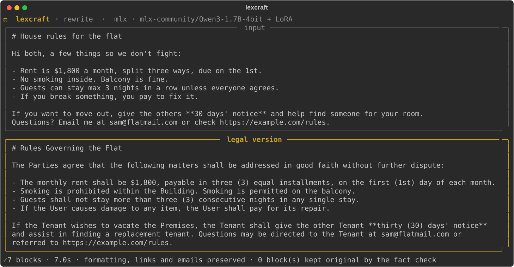
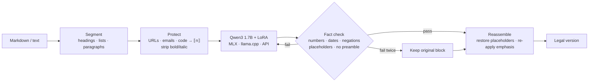
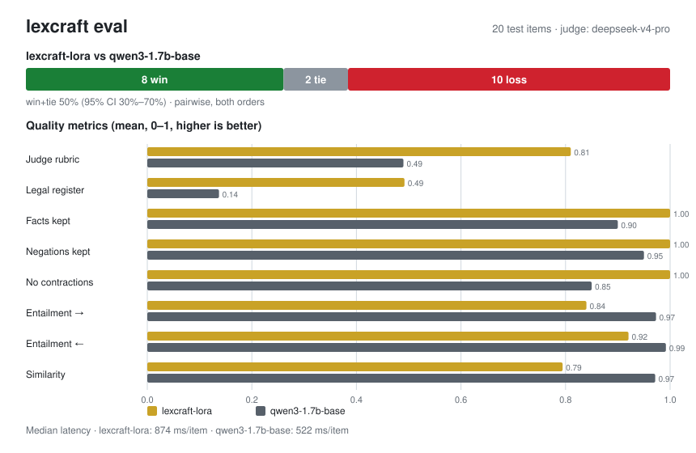

<div align="center">

# ⚖ lexcraft

**Rewrite plain text in formal legal language, on your own machine, with a 1.7B model.**

[](https://github.com/prat31/lexcraft/actions/workflows/ci.yml)
[](LICENSE)




</div>

lexcraft is a command-line tool that takes everyday text (emails, house rules, policies, notes) and
rewrites it in the style of a legal document. It keeps the facts, numbers and formatting of the
original. It runs [Qwen3 1.7B](https://huggingface.co/Qwen/Qwen3-1.7B) with a LoRA adapter trained
for this task, so it works offline on a laptop.

> [!WARNING]
> lexcraft changes how text is worded. It does not give legal advice, and it can change meaning.
> Have anything important checked by a lawyer.

## Contents

- [What it does](#what-it-does)
- [Quickstart](#quickstart)
- [Usage](#usage)
- [How it works](#how-it-works)
- [Evaluation](#evaluation)
- [Training](#training)
- [Ollama](#ollama)
- [Project layout](#project-layout)
- [Known limitations](#known-limitations)

## What it does

- Keeps Markdown intact. Headings, lists, quotes, code blocks, tables, links, URLs, emails and
  bold/italic are handled in code; the model only sees the prose.
- Checks every block after rewriting. Numbers, amounts, dates, emails, URLs, placeholders and
  negations have to survive. If a block fails, it is retried once; if it fails again, the original
  block is kept.
- Runs locally. The 4-bit model is about 1 GB and takes roughly 0.9 s per sentence on an M1 Pro.
  Nothing is sent anywhere unless you point it at a remote API.
- Uses MLX on Apple Silicon, llama.cpp (GGUF) on CUDA, Vulkan or CPU, or any OpenAI-compatible
  endpoint.

## Quickstart

You need Python 3.11–3.13 and [uv](https://docs.astral.sh/uv/) (pip works too).

```bash
git clone https://github.com/prat31/lexcraft.git
cd lexcraft
uv sync                      # on Apple Silicon this installs the MLX backend
uv run lexcraft doctor       # shows your hardware and which model files are ready
```

The adapter isn't checked in, so train it first (about an hour on an M1 Pro, see [Training](#training)):

```bash
uv run lexcraft data build
uv run lexcraft train
uv run lexcraft              # paste text, then Ctrl-D
```

<details>
<summary>Other platforms</summary>

```bash
# llama.cpp (GGUF) inference on NVIDIA or CPU
CMAKE_ARGS="-DGGML_CUDA=on" uv sync --extra llamacpp   # leave out CMAKE_ARGS for CPU only
# LoRA training on NVIDIA GPUs
uv sync --extra cuda
```

</details>

## Usage

```bash
lexcraft                                  # interactive: paste text, Ctrl-D to finish
lexcraft rewrite notes.md                 # rewrite a file and print the result
lexcraft rewrite notes.md -o legal.md     # write the result to a file
cat email.txt | lexcraft rewrite > out.txt
lexcraft rewrite notes.md --blocks        # before/after table per block, with check results
lexcraft rewrite notes.md --copy          # also copy the result to the clipboard
lexcraft rewrite notes.md --no-adapter    # run the base model without the LoRA
```

| Command | What it does |
|---|---|
| `lexcraft doctor` | Shows hardware, available backends and which model files exist |
| `lexcraft data build \| stats \| sample` | Validates, dedupes and splits the training pairs |
| `lexcraft train` | Trains the LoRA (MLX on Apple Silicon, PEFT on CUDA) with early stopping |
| `lexcraft export` | Fuses the LoRA and writes an 8-bit MLX model, plus a GGUF and Ollama Modelfile |
| `lexcraft serve` | Serves the local model over an OpenAI-compatible API |
| `lexcraft eval run \| models \| report` | Runs and shows evaluations |

Settings are in [`lexcraft.toml`](lexcraft.toml). API keys go in `.env` (see [`.env.example`](.env.example)).

## How it works



**Model.** `Qwen/Qwen3-1.7B` (Apache-2.0). On Apple Silicon, training and inference use the 4-bit
MLX build (QLoRA). The LoRA uses rank 16, alpha 32, all layers, loss on the answer only, a cosine
learning-rate schedule and early stopping on validation loss.

**Data.** 1,410 plain → legal pairs in 27 categories, in [`data/seed/`](data/seed). They cover
contracts, leases, employment, privacy, terms of service, notices, letters and complaints, long
paragraphs with many facts, everyday agreements, headings, list items, placeholders, casual or slang
input, and input that starts with a request like "make this legal:". The pairs were generated with
Claude and filtered with the same fact checks the tool runs on its output. `lexcraft data build`
splits them 80/10/10 by category: 1,128 train, 141 validation, 141 test.

## Evaluation



The last published run compares the LoRA with the same base model without it, on 20 test items,
judged by DeepSeek V4 Pro ([report](eval/results/base-vs-lora/report.md) ·
[HTML](eval/results/base-vs-lora/report.html) · [raw results](eval/results/base-vs-lora/results.json)).

| | LoRA | Base |
|---|---|---|
| Judge rubric score | **0.81** | 0.49 |
| Passes all checks | **60%** | 15% |
| Legal register | **0.49** | 0.14 |
| Facts kept | **1.00** | 0.90 |
| Meaning (NLI entailment →/←) | 0.84 / 0.92 | **0.97 / 0.99** |
| Pairwise (win / tie / loss) | 8 / 2 / 10 | |

The LoRA writes much more like a legal document and keeps every number. The base model scores higher
on meaning mostly because it often returns the input nearly unchanged. The LoRA's real weakness is that
it sometimes adds parties or details that aren't in the original, for example turning "you" into
"the Customer".

Be careful with these numbers:

- 20 items is a smoke test. The 95% interval on the pairwise result is 30–70%.
- This run used an older adapter (trained on 1,000 pairs) and an older judge setup. In that setup the
  base model could win a pairwise comparison just by copying the input. The judge is stricter now
  (see below), and the table will be replaced after the next full run on the 141-item test set.

### How it is measured

- [Promptfoo](https://promptfoo.dev) runs every model on the same prompt and test items.
- Code checks: facts, placeholders, negations, no country-specific terms, no preamble, no
  contractions, and legal register. An output that is a copy or light edit of the input fails the
  register check.
- An LLM rubric score, plus a pairwise judge that sees both outputs in both orders. The judge marks
  each output pass/fail on "reads as legal drafting" and "keeps the meaning". An output that fails
  either can't win. If both fail, the item is counted as "both fail", not a tie. If the two orders
  disagree, it's a tie.
- Embedding similarity and NLI entailment in both directions (does each text imply the other?).
- The judge has to come from a different model family than every model being compared. The runner
  refuses to start otherwise.

### Running it

```bash
uv sync --extra eval           # also needs Node.js 20+ for Promptfoo (run through npx)
cp .env.example .env           # add your API key(s)
uv run lexcraft eval models    # list models and judges, check the family rule
uv run lexcraft eval run --systems lexcraft-lora,qwen3-1.7b-base --limit 20 --open
uv run lexcraft eval run       # every model in eval/models.yaml, full test set
```

Models are configured in [`eval/models.yaml`](eval/models.yaml); any OpenAI-compatible endpoint
works. To try one without editing the file, use `--add <endpoint>:<model>`, and pick a judge with
`--judge <name>`. If a model only accepts one temperature, set `temperature:` on its entry.

## Training

```bash
uv run lexcraft data build              # validate and split data/seed into data/processed
uv run lexcraft train                   # shows train/val loss, stops early, keeps the best checkpoint
uv run lexcraft train --iters 400 --lr 5e-5 --rank 8   # override settings from lexcraft.toml
uv run lexcraft export                  # fused 8-bit MLX model (+ GGUF if llama.cpp is set up)
```

With the current settings (600 steps, batch size 4, sequences up to 768 tokens), training on a
16 GB M1 Pro takes about 7 s per step and peaks at about 3.8 GB of GPU memory. That's a bit over an
hour for a full run; early stopping can end it sooner. To add training pairs, put them in
`data/seed/*.jsonl` (see [CONTRIBUTING.md](CONTRIBUTING.md)) and run `data build` again.

## Ollama

You can run the published model without cloning this repo:

```bash
ollama run pratcode07/lexcraft "I received a defective coffee maker and your support refused a refund. If I don't get one within 15 days, I'll sue."
```

It's a rewriter, not a chat model. Send one piece of text per message. A follow-up like "now make it
first person" gets rewritten as more text. Use `/clear` between unrelated texts.

To build it yourself, `lexcraft export --gguf` writes a GGUF and a matching
[`Modelfile`](ollama/Modelfile) with the same system prompt and chat format used in training. The
conversion needs [llama.cpp](https://github.com/ggml-org/llama.cpp):

```bash
git clone https://github.com/ggml-org/llama.cpp ~/llama.cpp
uv venv ~/llama.cpp/.venv      # the converter needs torch; keep it out of lexcraft's env
uv pip install --python ~/llama.cpp/.venv/bin/python \
  -r ~/llama.cpp/requirements/requirements-convert_hf_to_gguf.txt "transformers>=5"
LLAMA_CPP_DIR=~/llama.cpp LLAMA_CPP_PYTHON=~/llama.cpp/.venv/bin/python uv run lexcraft export --gguf
cd artifacts/models && ollama create lexcraft -f Modelfile
ollama run lexcraft "You can't sublet the flat without asking me first."
```

Ollama only runs the model. The Markdown handling and fact checks live in the CLI. To get both, point
lexcraft at Ollama in `lexcraft.toml`: `backend = "remote"`,
`remote_base_url = "http://localhost:11434/v1"`, `remote_model = "lexcraft"`.

## Project layout

```
src/lexcraft/
  cli.py            CLI (rewrite, doctor, data, train, export, serve, eval)
  structure.py      Markdown segmentation, placeholders, emphasis
  engine.py         rewrite → check → retry → fall back → reassemble
  verify.py         fact, negation, region and register checks
  backends/         MLX, llama.cpp, OpenAI-compatible remote
  train.py          MLX QLoRA and CUDA PEFT training, early stopping
  export.py         fuse, quantize, GGUF, Ollama Modelfile
  evaluation/       Promptfoo config, pairwise judge, NLI metrics, reports
data/seed/          training pairs (the source of truth)
eval/models.yaml    models used in evals
eval/results/       published eval runs
```

## Known limitations

- It can change meaning when the input is loose. In the demo above, "split three ways" became "three
  (3) equal installments" and "unless everyone agrees" was dropped. The checks catch lost numbers,
  dates and negations, not every change in meaning, so read the output.
- It sometimes adds a party or detail that isn't in the input, such as "the Company" or "of the
  following month".
- Voice depends on the kind of text. Letters, emails, notices and complaints should keep "I", "we"
  and "you"; agreements, terms and rules use roles like "the Tenant". Short, ambiguous sentences can
  go either way.
- English only. It was trained on short blocks, and a long paragraph is rewritten as one block.

## License

[Apache-2.0](LICENSE). The base model, [Qwen3-1.7B](https://huggingface.co/Qwen/Qwen3-1.7B), is also
Apache-2.0. The training pairs in `data/seed/` were generated with Claude for this project.
