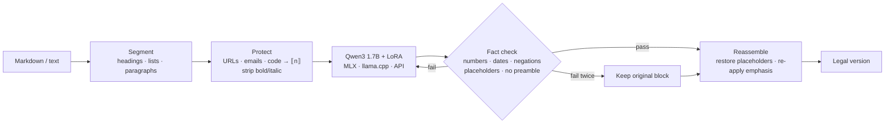

<div align="center">

# ⚖ lexcraft

**Turn plain text into formal, jurisdiction-neutral legal language — locally, with a 1.7B model.**

[](https://github.com/prat31/lexcraft/actions/workflows/ci.yml)
[](LICENSE)


</div>

lexcraft is an open-source CLI that rewrites everyday text — emails, house rules, policies, notes —
into legal drafting style while keeping the **meaning, facts and formatting** intact. It runs a small
open model ([Qwen3 1.7B](https://huggingface.co/Qwen/Qwen3-1.7B)) with a LoRA adapter trained for this
one job, so it works offline on a laptop.

> [!WARNING]
> lexcraft changes the *style* of text. It is not a lawyer and its output is not legal advice.
> Always have important documents reviewed by a qualified professional.

### LoRA vs base model


The adapter lifts the judge's rubric score from 0.49 to 0.81 and keeps every fact; details in
[Evaluation](#evaluation).

## Contents

- [Features](#features)
- [Quickstart](#quickstart)
- [Usage](#usage)
- [How it works](#how-it-works)
- [Evaluation](#evaluation)
- [Train your own adapter](#train-your-own-adapter)
- [Run with Ollama](#run-with-ollama)
- [Project layout](#project-layout)
- [Known limitations](#known-limitations)

## Features

- **Formatting preserved by code, not by luck.** Markdown headings, lists, quotes, code blocks, tables,
  links, URLs, emails and bold/italic survive exactly; only the prose is rewritten.
- **Fact guard.** Every block is checked: numbers, amounts, dates, emails, URLs and negations must
  survive. Failing blocks are retried, then kept as the original rather than silently changed.
- **Small and local.** ~1 GB 4-bit model, ~0.9 s per sentence on an M1 Pro. No data leaves your machine.
- **Hardware-aware.** MLX on Apple Silicon; llama.cpp (GGUF) on CUDA, Vulkan or CPU; or any
  OpenAI-compatible endpoint.
- **Reproducible eval.** Promptfoo matrix + blind pairwise LLM judge + NLI meaning checks, with
  every model role swappable in one YAML file.

## Quickstart

Requires Python 3.11–3.13 and [uv](https://docs.astral.sh/uv/) (or pip).

```bash
git clone https://github.com/prat31/lexcraft.git
cd lexcraft
uv sync                      # Apple Silicon: installs the MLX backend
uv run lexcraft doctor       # shows your hardware and what is ready
```

Then train the adapter (≈30–40 min on an M1 Pro, see [below](#train-your-own-adapter)) and paste text:

```bash
uv run lexcraft data build
uv run lexcraft train
uv run lexcraft              # paste text, finish with Ctrl-D
```

<details>
<summary>Other platforms</summary>

```bash
# NVIDIA / CPU inference via llama.cpp (GGUF)
CMAKE_ARGS="-DGGML_CUDA=on" uv sync --extra llamacpp   # drop CMAKE_ARGS for CPU-only
# LoRA training on NVIDIA GPUs
uv sync --extra cuda
```

</details>

## Usage

```bash
lexcraft                                  # interactive: paste text, Ctrl-D to finish
lexcraft rewrite notes.md                 # rewrite a file, print the result
lexcraft rewrite notes.md -o legal.md     # write to a file
cat email.txt | lexcraft rewrite > out.txt
lexcraft rewrite notes.md --blocks        # per-block before/after table with fact checks
lexcraft rewrite notes.md --copy          # also copy the result to the clipboard
lexcraft rewrite notes.md --no-adapter    # compare against the base model
```

| Command | What it does |
|---|---|
| `lexcraft doctor` | Hardware, available backends, which model files are ready |
| `lexcraft data build \| stats \| sample` | Validate, dedupe and split the training pairs |
| `lexcraft train` | Train the LoRA (MLX on Apple Silicon, PEFT on CUDA), with early stopping |
| `lexcraft export` | Fuse the LoRA, build an 8-bit MLX model and a GGUF + Ollama Modelfile |
| `lexcraft serve` | OpenAI-compatible API for the local model |
| `lexcraft eval run \| models \| report` | Run and inspect evaluations |

Configuration lives in [`lexcraft.toml`](lexcraft.toml); secrets go in `.env` (see [`.env.example`](.env.example)).

## How it works



- **Model:** `Qwen/Qwen3-1.7B` (Apache-2.0). On Apple Silicon training and inference use the 4-bit MLX
  build (QLoRA). LoRA rank 16, alpha 32, all layers, prompt-masked loss, cosine schedule, early stopping
  on validation loss.
- **Data:** 1,250 hand-written plain → legal pairs across 24 categories (contracts, leases, employment,
  privacy, terms of service, notices, everyday agreements, headings, list items, placeholders,
  casual/slang input). Every pair passes the same fact checks used at runtime.
  Split 80/10/10, stratified by category: [`data/seed/`](data/seed).

## Evaluation

The chart at the top is the latest published run: **LoRA vs the same base model without the adapter**, 20 stratified test items,
judged by DeepSeek V4 Pro ([full report](eval/results/base-vs-lora/report.md) ·
[interactive HTML](eval/results/base-vs-lora/report.html) · [raw results](eval/results/base-vs-lora/results.json)).

| | LoRA | Base |
|---|---|---|
| Judge rubric score | **0.81** | 0.49 |
| Passes all checks | **60%** | 15% |
| Legal register | **0.49** | 0.14 |
| Facts kept | **1.00** | 0.90 |
| Meaning (NLI entailment →/←) | 0.84 / 0.92 | **0.97 / 0.99** |
| Pairwise (win / tie / loss) | 8 / 2 / 10 | |

**How to read it:** the adapter makes the model write like a lawyer (rubric +0.32, register 3.5×) and
stops it dropping facts. The base model scores higher on meaning mostly because it barely changes the
input. The pairwise judge puts meaning first, so the two come out even (50% win+tie, 95% CI 30–70%).
With 20 items this is a smoke test, not proof — run the full 125-item test set for a real result.

**How it is measured**

- [Promptfoo](https://promptfoo.dev) runs every system on the same prompt and test items.
- Deterministic checks (facts, placeholders, negations, region-neutral terms, no preamble, no contractions).
- `llm-rubric` and a **pairwise judge run in both orders** to cancel position bias; disagreements count as ties.
- Sentence-embedding similarity and **bidirectional NLI entailment** (does each text imply the other?).
- The judge must come from a different model family than every compared system; the runner refuses otherwise.

**Run it yourself**

```bash
uv sync --extra eval           # + Node.js 20+ for Promptfoo (fetched via npx)
cp .env.example .env           # add your API key(s)
uv run lexcraft eval models    # see systems, judges and the family guard
uv run lexcraft eval run --systems lexcraft-lora,qwen3-1.7b-base --limit 20 --open
uv run lexcraft eval run       # everything in eval/models.yaml, full test set
```

Swap or add models in [`eval/models.yaml`](eval/models.yaml) — any OpenAI-compatible endpoint works.
Ad hoc: `--add <endpoint>:<model>`, `--judge <model>`.

## Train your own adapter

```bash
uv run lexcraft data build              # validate + split data/seed → data/processed
uv run lexcraft train                   # live loss, val loss, early stopping, best checkpoint
uv run lexcraft train --iters 400 --lr 5e-5 --rank 8   # override any setting
uv run lexcraft export                  # fused 8-bit MLX (+ GGUF if llama.cpp is available)
```

Training on a 16 GB M1 Pro takes ~5 s/step (peak ~3.3 GB GPU memory). Add pairs to `data/seed/*.jsonl`
(see [CONTRIBUTING.md](CONTRIBUTING.md)) and rebuild.

## Run with Ollama

`lexcraft export` writes a GGUF and a matching [`Modelfile`](ollama/Modelfile) (same system prompt and
chat format the adapter was trained with). It needs [llama.cpp](https://github.com/ggml-org/llama.cpp)
for the conversion:

```bash
git clone https://github.com/ggml-org/llama.cpp ~/llama.cpp
cmake -S ~/llama.cpp -B ~/llama.cpp/build && cmake --build ~/llama.cpp/build -j --target llama-quantize
uv pip install -r ~/llama.cpp/requirements/requirements-convert_hf_to_gguf.txt
LLAMA_CPP_DIR=~/llama.cpp uv run lexcraft export
cd artifacts/models && ollama create lexcraft -f Modelfile
ollama run lexcraft "You can't sublet the flat without asking me first."
```

> Ollama runs the raw model. The CLI adds structure preservation and the fact guard on top — to get
> both, point lexcraft at Ollama: set `backend = "remote"`, `remote_base_url = "http://localhost:11434/v1"`
> and `remote_model = "lexcraft"` in `lexcraft.toml`.

## Project layout

```
src/lexcraft/
  cli.py            Typer CLI (rewrite, doctor, data, train, export, serve, eval)
  structure.py      markdown segmentation, placeholders, emphasis handling
  engine.py         rewrite → verify → retry → fallback → reassemble
  verify.py         deterministic fact / negation / region / register checks
  backends/         mlx · llama.cpp · OpenAI-compatible remote
  train.py          MLX QLoRA and CUDA PEFT training, early stopping
  export.py         fuse, quantize, GGUF, Ollama Modelfile
  evaluation/       Promptfoo config, pairwise judge, NLI metrics, reports
data/seed/          training pairs (source of truth)
eval/models.yaml    every eval model role, swappable
eval/results/       published eval runs
```

## Known limitations

- **Meaning drift on loose phrasing.** In the demo above, "split three ways" becomes "three equal
  installments" and "unless everyone agrees" is dropped. The fact guard catches numbers, dates and
  negations, not every change of meaning — read the output.
- **Pronouns become roles** ("you" → "the Tenant"). This is normal legal drafting but invents party
  names; the judge counts it against the model.
- **English only**, trained on short blocks (≤ a few sentences). Long paragraphs are rewritten as one block.
- Results above are from a small run; frontier models (GPT, Gemini) still score higher on meaning.

## License

[Apache-2.0](LICENSE). The base model [Qwen3-1.7B](https://huggingface.co/Qwen/Qwen3-1.7B) is also
Apache-2.0. Training pairs in `data/seed/` were written with Claude for this project.
